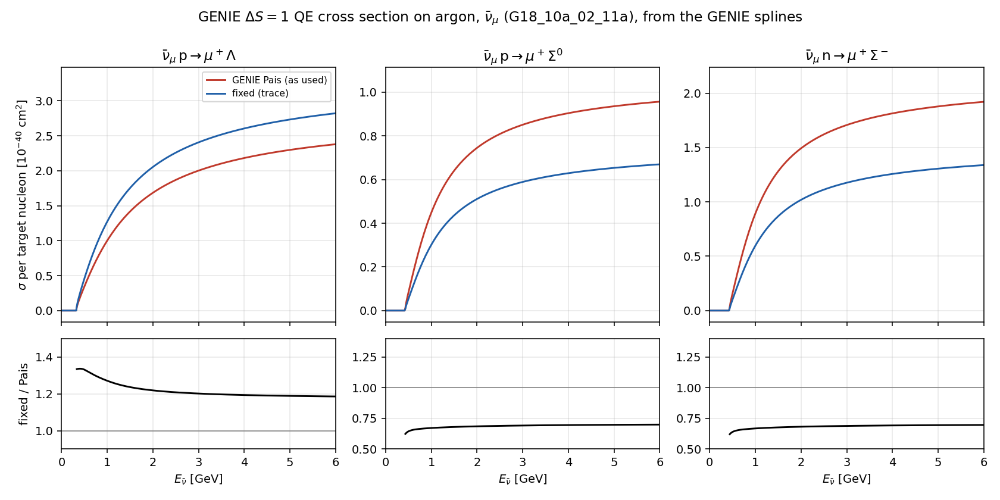
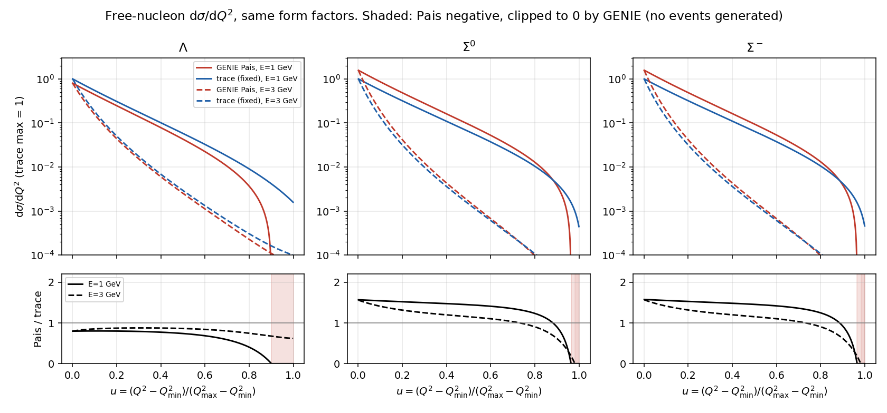
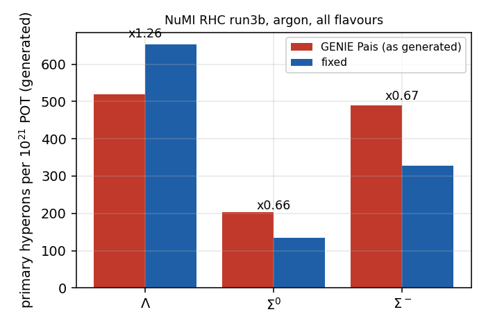
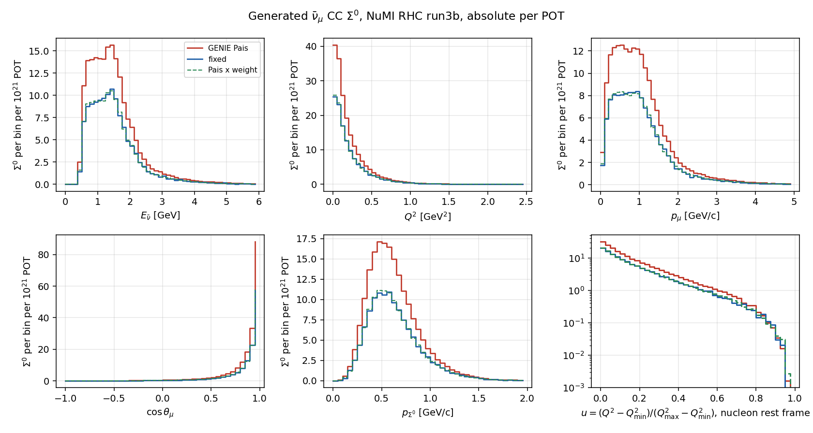
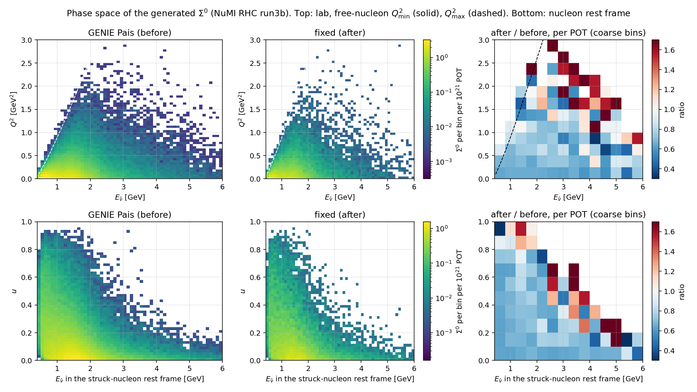

# GENIE's ν̄ hyperon quasi-elastic cross section: the bug and the fix

*J. Nowak, 2026-11-02. Figures: `make_figures.py` in this directory. Fix: `../README.md`
(`genie::HypQELTracePXSec`).*

## Summary

GENIE models ΔS = 1 quasi-elastic hyperon production, ν̄ p → l⁺ Λ, ν̄ p → l⁺ Σ⁰ and ν̄ n → l⁺ Σ⁻,
with `genie::PaisQELLambdaPXSec`. This model is wrong in its hyperon–nucleon mass-difference terms.
It was checked in v3_00_04_ub4 (as used by uboonecode v08_00_00_85) and v3_00_06.

The check compares it with the full contraction of the leptonic and hadronic tensors, L_μν H^μν,
computed with the same SU(3) form factors. Against that, GENIE's cross section is:

- Λ: **16–21% too low**;
- Σ⁰ and Σ⁻: **1.43–1.49× too high** (1–5 GeV);
- Σ⁰/Λ: 0.45 instead of 0.24.

When the final baryon has the nucleon mass, the main error vanishes and the expression comes within
1% of Llewellyn Smith CCQE, which is why it went unnoticed. The two faulty lines are below. NuWro's hyperon model agrees with the contraction.

We replaced the model with `genie::HypQELTracePXSec`, which evaluates the contraction numerically.
Everything else is kept: form factors, Cabibbo angle, integration and nuclear scaling.

For MicroBooNE NuMI RHC the fix moves the generated rates by:

| Λ | Σ⁰ | Σ⁻ |
|---|---|---|
| ×1.26 | ×0.66 | ×0.67 |

The old expression also turns negative near the kinematic limit Q²_max. GENIE clips it to zero
there, so the old samples have no events in that corner of phase space. That corner holds at most
0.16% of the correct cross section.

## How it was found

Comparing the true Λ and Σ⁰ yields of GENIE and NuWro gave Σ⁰/Λ = 0.45 in GENIE, against 0.21 in
NuWro, for the same form factors. Two independent calculations then agree with NuWro:

- a direct evaluation of L_μν H^μν from Dirac matrices (`../../pelee/HypXsecWeights.py`);
- its C++ port into GENIE.

The Python calculation also reproduces Llewellyn Smith CCQE (ν 1.06, ν̄ 0.41 ×10⁻³⁸ cm² at 1 GeV).

## The faulty lines

The code is `src/Physics/Strange/XSection/PaisQELLambdaPXSec.cxx`, `PaisQELLambdaPXSec::XSec`. It is
unchanged on GENIE `master` (checked 2026-11-02). GENIE writes dσ/dQ² as a quadratic in (s−u),
built from three structure terms `w1`, `w2`, `w3`. There are two errors.

**1. The Gordon coefficient for equal masses (the main bug).** For on-shell spinors,
f₁γ^μ + i(ξF₂/2M)σ^{μν}q_ν = [f₁ + ξF₂(M_N+M_Y)/2M] γ^μ − (ξF₂/2M)(p_N+p_Y)^μ. GENIE writes the
γ^μ coefficient as `(F1V + xiF2V)`, which is right only when M_Y = M_N = M. It appears in `w1`,
`w2` and `w3`.

**2. A missing M² in the second term.** `-4*(Mnuc2*v2 - q2)*w2` subtracts q² (GeV²) from
M²ν² (GeV⁴). The correct term is `-4*Mnuc2*(v2 - q2)*w2`.

```cpp
// GENIE (v3_00_04 ... master)
double w1 = (Mm2 - q2)/(4*Mnuc2)*TMath::Power((F1V + xiF2V), 2) + (Mp2 - q2)/(4*Mnuc2) * FA2;
double w2 = FA2 + TMath::Power((F1V + xiF2V - Mp * xiF2V / (2 * Mnuc)), 2) - q2 / Mnuc2 * TMath::Power((xiF2V / 2), 2);
double w3 = 2 * FA * (F1V + xiF2V);
double xsec = Gf*fSin8c2 / (16*Mnuc2*E2) * (-8*Mnuc2*q2*w1 - 4*(Mnuc2*v2 - q2)*w2 - sign*2*(s - u)*q2*w3 + (s-u)*(s-u)*w2);

// corrected
double FM = F1V + Mp * xiF2V / (2 * Mnuc);        // gamma^mu coefficient for M_Y != M_N
double w1 = (Mm2 - q2)/(4*Mnuc2)*TMath::Power(FM, 2) + (Mp2 - q2)/(4*Mnuc2) * FA2;
double w2 = FA2 + TMath::Power(F1V, 2) - q2 / Mnuc2 * TMath::Power((xiF2V / 2), 2);   // (FM - Mp xiF2V/2M) = F1V
double w3 = 2 * FA * FM;
double xsec = Gf*fSin8c2 / (16*Mnuc2*E2) * (-8*Mnuc2*q2*w1 - 4*Mnuc2*(v2 - q2)*w2 - sign*2*(s - u)*q2*w3 + (s-u)*(s-u)*w2);
```

With a massless lepton, the corrected expression equals the exact contraction identically
(symbolic check, `derivation/sym.py`). What remains are the lepton-mass terms that GENIE drops
everywhere in this class. Effect of each fix on σ, relative to the exact contraction:

| | GENIE | fix 1 only | fix 2 only | fixes 1+2 |
|---|---|---|---|---|
| Σ⁰, 1 / 2 GeV | 1.523 / 1.489 | 0.990 / 0.998 | 1.546 / 1.494 | 1.007 / 1.002 |
| Λ, 1 / 2 GeV | 0.788 / 0.823 | 0.978 / 0.995 | 0.807 / 0.828 | 1.001 / 1.001 |
| M_Y = M_N, 1 GeV | 0.990 | 0.990 | 1.003 | 1.003 |

The Gordon coefficient is the factor 1.5. The missing M² is 1–2%, which is why the equal-mass limit
looked right (1% off). The rest, 0.1–0.7%, is the lepton-mass terms. `genie::HypQELTracePXSec`
evaluates the full contraction, lepton-mass terms included. The five corrected lines above are the
minimal patch to the existing class.

`derivation/`:
- `terms.py` extracts the coefficients of (s−u)⁰, (s−u)¹ and (s−u)² from the exact trace, one
  coupling at a time;
- `exact.py` checks the closed form against the trace (agreement to 3×10⁻¹² for every coupling
  combination);
- `sym.py` derives the closed form, applies each fix, and integrates σ.

## Cross section



*Figure 1. ν̄μ cross section per target nucleon on argon, from GENIE's own splines (tune
G18_10a_02_11a): the production Pais splines and splines made by GENIE with the fixed algorithm.
Argon scales exactly as the free nucleon.*

| ν̄μ on Ar | 1 GeV | 2 GeV | 5 GeV |
|---|---|---|---|
| Λ fixed / Pais | 1.271 | 1.219 | 1.189 |
| Σ⁰ fixed / Pais | 0.672 | 0.686 | 0.698 |
| Σ⁻ fixed / Pais | 0.668 | 0.683 | 0.695 |
| Σ⁰/Λ: Pais → fixed (1 GeV) | | 0.447 → 0.237 | |

## Shape in Q² and the phase space the old model misses



*Figure 2. Free-nucleon dσ/dQ² against u = (Q² − Q²_min)/(Q²_max − Q²_min), with the same form
factors on both sides. Shaded: the region where the Pais expression is negative and GENIE clips it
to zero.*

The error is not only in the normalisation. For Σ⁰ and Σ⁻ the Pais expression is about 1.55× too
high at low Q². The excess falls towards high Q², the curve crosses the correct one near u ≈ 0.85,
and it goes negative above u ≈ 0.96 at 1 GeV (u ≈ 0.98 at 3 GeV). For Λ it is about 0.8× everywhere
at low energy and goes negative above u = 0.90 at 1 GeV.

| clipped region (Pais < 0) | 1 GeV | 3 GeV | correct σ in that region |
|---|---|---|---|
| Λ | u > 0.90 | none | 0.16% (1 GeV) |
| Σ⁰ | u > 0.965 | u > 0.98 | 0.02% |
| Σ⁻ | u > 0.965 | u > 0.98 | 0.02% |

## Generated samples: rates, kinematics, phase space

These are the generated NuMI RHC run3b samples on argon:
- **old:** GENIE Pais, 3,050 chunks, 1.25×10²⁴ POT;
- **fixed:** fixed GENIE, 443 chunks so far, 1.98×10²³ POT.



*Figure 3. Primary hyperons per 10²¹ POT, from the chunk summaries.*



*Figure 4. ν̄μ CC Σ⁰ kinematics, absolute per POT. Green dashed: the old sample with the per-event
cross-section weight w(E_rest, u) that the analysis has used until the fixed samples are ready
(`../../pelee/HypXsecWeight.h`).*

The weighted old sample reproduces the fixed generation in normalisation and in every distribution:

| | Σ⁰ per 10²¹ POT |
|---|---|
| old | 191.9 |
| old × weight | 127.9 |
| fixed | 127.4 |



*Figure 5. Phase space of the generated Σ⁰. Top: lab (E_ν̄, Q²) with the free-nucleon limits.
Bottom: E_ν̄ in the struck-nucleon rest frame against u. Right: fixed/old per POT.*

Both generations cover the same region except the band next to Q²_max, which only the fixed model
fills. That band is negligible in rate:

| | old | fixed |
|---|---|---|
| Σ⁰ events with u > 0.8 | 0.31% | 0.46% |
| Σ⁰ events with u > 0.9 | 0.027% | 0.040% |

The main effect of the fix is the change in normalisation and the softer Q² spectrum (Figures 2
and 4), not new phase space.

## Consequences for the analysis

- **GENIE Σ⁰ signal ×0.66.** With the fix, and the Σ⁰ polarisation weight, the GENIE/NuWro ratio
  of predicted Σ⁰ is 4.19. Almost all of it comes from hyperon final-state interactions, which
  NuWro models and GENIE does not.
- **Real-Λ background ×1.26.** This is the ν̄p → μ⁺Λ background, about a third of the Λ-style
  background. The published MicroBooNE Λ measurement was compared with the uncorrected GENIE, and
  the fix moves that prediction by the same factor.
- **Until the regenerated samples replace the old ones,** every GENIE sample carries the per-event
  weight (Figure 4 validates it). The overlay and dirt keep the weight permanently.
- **The fix does not change** the hyperon polarisation (Geant4 decays Σ⁰ → Λγ and Λ → Nπ
  isotropically; that is a separate weight, `../../pelee/PolWeights.C`), or GENIE's lack of
  hyperon re-interactions.
- **The axial mass is not the explanation.** GENIE (tune M_A = 0.961 GeV) and NuWro (1.000 GeV)
  use the same dipole form factors and SU(3) couplings. Changing M_A moves Σ⁰ by 0.4%.
- **To do:** report the problem to the GENIE authors, with Figures 1 and 2 and the trace
  calculation.

## Reproduce

```bash
cd Sigma/genie_hypfix/doc && python3 make_figures.py      # ~20 min; prints every number quoted here
```

Inputs:
- the merged spline file `/data/uboone/genie_samples/hypfix_splines/gxspl-FNALsmall-hypfix.xml`;
- the generated chunks under `/data/uboone/genie_samples/genie_uboone_NuMI_RHC_sigmazero_run3b_2026{,_hypfix}/chunks`;
- `../../pelee/hyp_xsec_weights.root` and `../../pelee/HypXsecWeights.py`.
